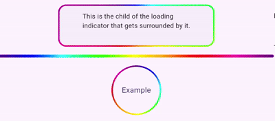
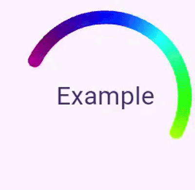

<!--
This README describes the package. If you publish this package to pub.dev,
this README's contents appear on the landing page for your package.

For information about how to write a good package README, see the guide for
[writing package pages](https://dart.dev/guides/libraries/writing-package-pages).

For general information about developing packages, see the Dart guide for
[creating packages](https://dart.dev/guides/libraries/create-library-packages)
and the Flutter guide for
[developing packages and plugins](https://flutter.dev/developing-packages).
-->

Library to create colorful loading indicator

The current state is under active development but considered stable.
This ReadMe and all examples will be improved once V2 is done.

I recommend to take a look at the [example project](https://colorful-progress-indicator.memeozer.com)

## Features

- GradientColors (Razer Chroma and some Pride gradients)

V1 (0.1.1)
- FixedGradientProgressIndicator (also as Circular and Linear)
- MovingGradientProgressIndicator (also as Circular and Linear)

V2 (current)
- FixedGradientProgressIndicator (also as Circular)
- MovingGradientProgressIndicator (also as Circular and Linear)

With package version 0.2.0, all progress indicator will gradually be based on CustomPainter instead 
of relying on BoxDecorations.
All old progress indicator are available under the new import `colorful_progress_spinner_v1.dart` 
and are renamed to `<OldName>V1`.

With 0.2.0:
- the api surface has been reduced
- visual artifacts has been removed (see live example above)
- progress indicator no longer create a fake background, allowing for real transparency of the child 

## Getting started

```terminal
dart pub add colorful_progress_spinner
```

## Usage

(see /example folder or checkout the linked website above for different examples)

Example of a moving indicator
```dart
var radius = BorderRadius.only(
  topLeft: Radius.circular(20),
  bottomRight: Radius.circular(20),
);
var width = 10;

MovingGradientProgressIndicator(
    duration: const Duration(seconds: 5),
    colors: [
        ...GradientColors.razerChroma,
        GradientColors.razerChroma.first,
    ],
    borderRadius: radius,
    width: width,
    child: Card(
        shape: RoundedRectangleBorder(
          borderRadius: radius,
        ),
        margin: EdgeInsets.all(width / 2),
        child: Padding(
            padding: EdgeInsets.all(12),
            child: Column(
                mainAxisSize: MainAxisSize.min,
                children: [
                  Text("This is the child of the loading\nindicator that gets surrounded by it."),
                ],
            ),
        ),
    ),
);
```

See the live example at the [example project](https://colorful-progress-indicator.memeozer.com)

Example of all`MovingGradientProgressIndicator`.



Example of `CircularFixedGradientProgressIndicator`.



## Additional information

My personal main goal was to recreate the Chroma spinner animation of [Razer](https://www.razer.com).

While this package achieves this goal, it has no explicit RazerChromaIndicator widget kind of stuff.